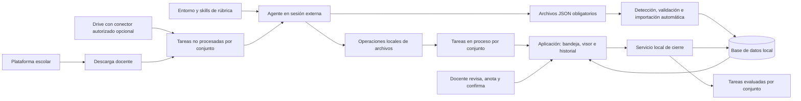

# Arquitectura lógica

## Dos entornos, una aplicación
Los agentes de desarrollo construyen la aplicación mediante SDD. Los agentes académicos operan sobre el repositorio desde una sesión externa, leen reglas/skills basadas en rúbricas, trasladan tareas a proceso y generan JSON obligatorios; la aplicación los importa automáticamente. La aplicación no aloja un agente de IA ni invoca una API de modelos de pago.

## Frontera agente/aplicación
El agente escribe JSON obligatorios en storage/resultados-json/pendientes/. La aplicación detecta resultados completos, valida esquema y referencias y persiste mediante un importador transaccional. Explora al iniciar y durante ejecución; con la app cerrada, importa al siguiente inicio. No hay escritura directa del agente en DB ni canales alternativos que omitan JSON; tampoco se requiere importación manual por tarea.

Las operaciones de listar conjuntos, reclamar tareas y mover archivos pueden disponer de utilidades locales sin conceder al agente acceso directo a SQLite. El registro de preevaluación siempre se materializa primero como archivo JSON. Diseño detallado de esas utilidades y separación de permisos pendiente.

## Capas previstas
src/domain/: conjuntos, entregas, rúbricas, puntuaciones, estados y permisos por función. src/services/: incorporación, inicio, registro de preevaluación, revisión, confirmación y movimientos coordinados. src/infrastructure/: DB, archivos, validación, recuperación. src/pages/, src/components/, src/styles/: interfaz y visor si se adopta Astro. scripts/: operaciones invocables por agente y automatización de cierre. contracts/: esquema JSON versionado y ejemplos sintéticos. tests/: reglas, integración y recorrido docente.

## Movimiento e integridad
IDs de archivos y hashes estables; ruta física cambia por etapa. DB almacena estado académico y operación de movimiento. Filesystem y SQLite no comparten transacción: registrar intención, mover sin sobrescribir, verificar destino/hash y completar; ante interrupción reconciliar. Archivo original conserva contenido aunque cambie de carpeta.

## Interfaz docente
Bandeja de conjuntos; lista de tareas; selección anterior/siguiente en visor integrado; panel de criterios y anotaciones de agente/docente; puntuaciones editables; guardado y confirmación explícita; histórico de tarea y global filtrable. Un lote no se cierra por evaluar una única tarea. El traslado final se ejecuta automáticamente desde la aplicación y no requiere agente activo.
