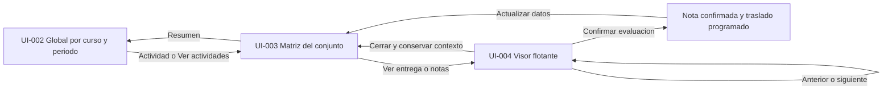

# Interfaces y wireframes — concepto 01

## Estado y procedencia

Especificación de distribución derivada de los tres mockups conceptuales generados en este chat e incorporada por solicitud del docente. Es una base de implementación y revisión, no una interfaz ya construida ni aprobación de cada detalle de las imágenes. Referencias raster conservadas junto a esta nota en assets/mockups-concepto-01/. Los nombres, notas y datos son ficticios.

Las imágenes ilustran disposición, no reglas de negocio: sus cifras de resumen, cantidad de columnas y alumnos no son requisitos. Se corrigen ambigüedades visuales: una tarea preevaluada muestra solo sugerencia IA hasta que exista borrador docente; no mostrar una calificación docente inventada como ocurre en algunas filas del mockup. La nota final se etiqueta como confirmada; el borrador no contribuye a acumulados finales.

Fuente funcional: [vistas de calificaciones](vistas-calificaciones.md). Estilo: [guía visual](../standards/interfaz-visual.md). Requisitos RF-018 a RF-022 y RF-001/007/008/009/017, sin renumeración.

## Convenciones de lectura

Wireframes ASCII: [texto] indica control; v indica selector; < > indican navegación; --- indica separación y no un borde literal obligatorio. Diagramas no a escala. La jerarquía y comportamiento son requisitos de interfaz; medidas siguientes son propuestas iniciales ajustables tras probar legibilidad.

## UI-001 — Estructura compartida

```text
+------------------+-----------------------------------------------------------+
| Evaluador        | [Curso v]       [Grupo v]       [Periodo v]                |
+------------------+-----------------------------------------------------------+
| Resumen          | Migas de navegacion / Contexto actual                     |
| Entregas         | Titulo de vista                         [Accion principal] |
| Alumnos          | Descripcion breve                                         |
| Historial        |                                                           |
|                  | Filtros de la vista                                       |
| Configuracion    | --------------------------------------------------------- |
|                  | Contenido principal                                       |
|                  | Tabla / estado vacio / carga / error                      |
+------------------+-----------------------------------------------------------+
```

Barra lateral estrecha a la izquierda, cabecera de contexto arriba y área principal expansible. Navegación activa indicada por fondo/acento y texto. Curso/grupo/período se seleccionan en la cabecera compartida: los filtros duplicados de la primera imagen son redundancia conceptual y no deben reproducirse sin necesidad. Al cambiar contexto se recargan datos asociados y se atienden cambios sin guardar antes de abandonarlos.

Entradas Resumen, Entregas e Historial corresponden a funciones existentes; Alumnos y Configuración son puntos de navegación previstos, no nuevas features completas especificadas por esta nota. No mostrar controles operativos que aún no tengan destino implementado. No añadir búsqueda global, cuentas o integraciones por aparecer un icono en un mockup.

Propuesta escritorio: lateral 200–240 px, cabecera 56–64 px, separación principal 24–32 px. Ajustar con texto real y escalado de navegador; no imponer alturas fijas a contenido multilínea.

## UI-002 — Calificaciones globales

Referencia: [mockup 1](assets/mockups-concepto-01/01-calificaciones-globales.png).

```text
+------------------+-----------------------------------------------------------+
| Evaluador        | [Geografia Economica v] [Grupo A v] [Primer parcial v]    |
+------------------+-----------------------------------------------------------+
| > Resumen        | Calificaciones globales                  [Ver actividades]|
|   Entregas       | Primer parcial - datos del contexto seleccionado          |
|   Alumnos        |                                                           |
|   Historial      | 24 alumnos | actividades revisadas | tareas pendientes    |
|                  | --------------------------------------------------------- |
|   Configuracion  | Alumno       | T1 /10 | T2 /20 | ... | Acumulado | Progreso|
|                  |--------------+--------+--------+-----+-----------+---------|
|                  | Lucia Torres |    8   |   15   | ... | 23 / 30   | 2 de 4 |
|                  | Diego ...    |    6   |   --   | ... |  6 / 10   | 1 de 4 |
|                  | ...          |        |        |     |           |        |
|                  | --------------------------------------------------------- |
|                  | Solo incluye calificaciones confirmadas. [Ver regla]      |
|                  |                                                           |
|                  | Actividad reciente                         [Ver historial]|
|                  | - Evaluacion confirmada ...                               |
+------------------+-----------------------------------------------------------+
```

Contenido prioritario: tabla comparativa. Resumen compacto, sin sustituir tabla por tarjetas. Una fila por alumno; columnas de actividades del período dinámicas, con máximo o peso visible; acumulado y avance al final. Progreso y contadores se calculan desde el mismo conjunto filtrado, con definición visible de la unidad (tareas/actividades), sin copiar totales incoherentes del raster.

Alumno y encabezado permanecen visibles durante desplazamiento; columnas restantes permiten scroll horizontal. Seleccionar encabezado/nombre de actividad abre su matriz; Ver actividades conduce a la lista de conjuntos del contexto. Acumulado abre desglose de contribuciones y regla, con tratamiento de pendientes explícito. Actividad reciente es información secundaria y puede omitirse en pantallas pequeñas.

Estados de celda: confirmada → número; pendiente → guion y etiqueta; sin entrega → texto específico; sin regla de cálculo → acumulado no calculado y acción para configurarla. Cero confirmado se representa 0, nunca guion. Escala/pesos y reglas provienen del curso, no de lo generado en imágenes.

## UI-003 — Matriz de evaluación de un conjunto

Referencia: [mockup 2](assets/mockups-concepto-01/02-matriz-evaluacion.png).

```text
+------------------+-----------------------------------------------------------+
| Evaluador        | [Curso v]              [Grupo v]             [Periodo v] |
+------------------+-----------------------------------------------------------+
|   Resumen        | Entregas / Primera tarea del parcial                      |
| > Entregas       | Primera tarea del parcial                                 |
|   Alumnos        | 24 alumnos - Rubrica v1.0                                 |
|   Historial      |                                                           |
|                  | [Buscar alumno........] [Estado v] [Criterios visibles v] |
|   Configuracion  | --------------------------------------------------------- |
|                  | Alumno | Estado | C1 /2 | C2 /3 | ... | Total | Notas | Ver|
|                  |--------+--------+-------+-------+-----+-------+-------+----|
|                  | Lucia  |Revision| 1.5 D | 2.5 D | ... | 8.0 D | 3 notas|[>]|
|                  |        |        |1.0 IA |2.5 IA |     |7.5 IA |        |   |
|                  | Mateo  |Pre-eval|2.0 IA |2.0 IA | ... |7.5 IA | 2 notas|[>]|
|                  | Sofia  |Evaluada| 2.0 D | 3.0 D | ... |10.0 D | Ver    |[>]|
|                  | Pablo  |Sin ent.|  --   |  --   | ... | --    | --     | --|
|                  | --------------------------------------------------------- |
|                  | D: docente (borrador/confirmada segun estado) | IA: sugerida|
+------------------+-----------------------------------------------------------+
```

Las abreviaturas del wireframe se expanden en etiquetas accesibles. Cada criterio muestra máximo y procedencia del valor; el valor docente es principal cuando existe y se distingue borrador/confirmado por etiqueta/estado. Sin valor docente se muestra sugerencia IA etiquetada, no una supuesta nota revisada. Un resultado parcial conserva sus limitaciones.

Filtros: búsqueda por nombre/identificador; estado de tarea; criterios visibles (selección de columnas, no filtro oculto de alumnos). Notas resume conteo o fragmento breve; al activarlo abre el visor en Anotaciones. Acción Ver entrega por fila abre documento/versión correctos. Si hay múltiples archivos, selector dentro del visor; sin entrega, mostrar ausencia y no abrir visor vacío.

Primera columna y encabezados persistentes, números alineados a derecha, scroll horizontal sin encoger texto indefinidamente. No exigir edición inline de todas las celdas en esta versión: el mockup no define una hoja de cálculo. La revisión/edición detallada ocurre en el visor; ordenar y filtrar no modifica calificaciones.

## UI-004 — Ventana flotante de revisión

Referencia: [mockup 3](assets/mockups-concepto-01/03-visor-flotante.png).

```text
 TABLA ATENUADA DETRAS - conserva filtros, seleccion y desplazamiento
 +----------------------------------------------------------------------------+
 | Lucia Torres                         [<] 3 de 24 [>] [Ampliar] [Cerrar X]  |
 | Primera tarea - entrega-v1.pdf - En revision  [Archivo v, si hay varios]   |
 +----------------------------------------------------+-----------------------+
 | [Miniaturas] [Pagina 2/5] [-] [100% v] [+]          | [Criterios] [Anotac.] |
 +---------+------------------------------------------+-----------------------+
 | pag. 1  |                                          | AGENTE IA - pag. 2    |
 | pag. 2* |  PAGINA DEL DOCUMENTO                    | Falta referencia ...  |
 | pag. 3  |  Titulo, texto y evidencia resaltada      | [Ver evidencia]       |
 | ...     |                                          |-----------------------|
 |         |  Seleccion -> [Anadir anotacion]          | DOCENTE - pag. 2      |
 |         |                                          | Verificar edicion ... |
 |         |                                          |-----------------------|
 |         |                                          | [Nota docente.......] |
 |         |                                          | [Criterio opcional v] |
 |         |                                          | [Guardar nota]        |
 +---------+------------------------------------------+-----------------------+
 | Borrador guardado     Calificacion [8.0] /10  [Cerrar] [Confirmar evaluacion]|
 +----------------------------------------------------------------------------+
```

Propuesta escritorio: ventana centrada de aproximadamente 88–94% del ancho/alto disponible; documento 60–70% del cuerpo y revisión 30–40%. Mantener mínimos legibles; permitir ampliar y colapsar miniaturas. Cabecera y pie permanecen disponibles; documento y panel tienen scroll independiente. La proporción concreta se valida con muestras reales, no se fija por el tamaño de la imagen.

Cabecera identifica alumno, actividad, archivo, versión y estado; anterior/siguiente recorre filas con entrega del listado filtrado/ordenado de origen y conserva ese orden durante la sesión de revisión. Si el conjunto cambia por nuevas importaciones, avisar y permitir actualizar sin saltos silenciosos. El indicador se refiere a tareas navegables, no al total del curso.

Panel Criterios: máximo, evidencia, sugerencia IA, puntuación docente y limitaciones por criterio. Panel Anotaciones: comentarios IA/docente etiquetados con autor, página/localización y criterio, y editor de nota docente. El texto original del agente conserva procedencia; el docente puede responder o registrar revisión, no reescribirlo como si fuera salida del agente. Evidencia seleccionada abre la página y marca el anclaje si existe.

La calificación del pie se calcula según rúbrica. Si hay puntuación desglosada por criterio, editarla en Criterios; no mantener un total independiente contradictorio. Override global, si se habilita después, requiere regla y motivo registrados; no se supone autorizado por el campo del mockup. Confirmar valida requisitos, persiste nota/historial y programa movimiento; no cierra ni navega automáticamente sin comportamiento acordado. Si falla el traslado, mostrar evaluada con traslado pendiente y conservar confirmación.

## UI-005 — Guardado, cierre y accesibilidad

Estado de edición: Sin cambios → Guardando → Guardado o Error. Guardar nota persiste borrador; confirmar evaluación es otra acción. Cambios de criterio o comentario no guardados deben guardarse o resolverse antes de anterior/siguiente, cambio de archivo, cierre, Escape o cambio de contexto. Un error de guardado mantiene contenido y ofrece reintento; no marcar Guardado por actualizar solo estado local.

Propuesta: autoguardado de borradores y botón explícito Guardar nota para comentarios. Evitar duplicados por clic/reintento; mostrar estados reales del servidor. Cuando el usuario solicita cierre con cambios pendientes ofrecer Guardar y cerrar, Seguir revisando y Descartar cambios no guardados con decisión explícita. Escape sigue esa misma política. No descartar un borrador ya persistido por cerrar el visor.

Modal con nombre accesible y foco inicial adecuado; Tab/Shift+Tab permanecen dentro, fondo inactivo y foco retorna al botón de la fila. Iframe, si se usa, necesita título y gestión de foco/comunicación comprobada; el iframe no implementa anotaciones ni contratos por sí mismo. No cargar rutas externas arbitrarias. Referencia técnica existente: [guía visual](../standards/interfaz-visual.md).

## UI-006 — Adaptación y estados de fallo

```text
 PANTALLA ESTRECHA - visor ocupa superficie disponible
 +-----------------------------------------+
 | Alumno / tarea             [<] [>] [X] |
 | [Documento] [Criterios] [Anotaciones]   |
 +-----------------------------------------+
 | Panel activo con scroll                 |
 | Documento O criterios O notas           |
 +-----------------------------------------+
 | Estado guardado      [Confirmar]        |
 +-----------------------------------------+
```

Lateral colapsable en móvil/tablet; no ocultar contexto del curso. Visor alterna paneles conservando notas/página; no apilar dos columnas ilegibles. Matriz conserva nombres de alumno y usa desplazamiento horizontal o selección de criterios; no elimina notas y acción Ver entrega. No se fija breakpoint antes de probar contenido y zoom.

| Estado | Presentación y acción |
|---|---|
| Cargando | Indicador en zona afectada, sin datos de otro alumno bajo el nuevo nombre |
| Sin alumnos/conjuntos | Explicación contextual y acceso a preparación ya implementada |
| Sin entrega | Celda etiquetada; no visor vacío ni calificación cero automática |
| Preevaluación pendiente | Estado explícito; no inventar criterios/notas del agente |
| JSON rechazado | Diagnóstico de importación; conservar datos aceptados anteriores |
| Documento ilegible/no compatible | Aviso en panel documental; criterios y notas siguen consultables |
| Guardado fallido | Texto permanece; reintentar; proteger navegación de descarte |
| Confirmación fallida | No declarar evaluada; mantener borrador y motivo |
| Traslado fallido tras confirmar | Nota confirmada y traslado pendiente/reintento visibles |

## Navegación entre vistas



## Aceptación y trazabilidad

| UI | Requisitos/aceptación | Feature | Verificación |
|---|---|---|---|
| UI-001/002 | RF-018/022; CA-018/022 | FEAT-005 | PR-022/025/026 |
| UI-003 | RF-019/022; CA-019/022 | FEAT-004 | PR-023/025 |
| UI-004 | RF-007/008/009/020; CA correspondientes | FEAT-004 | PR-006/007/024 |
| UI-005/006 | RF-017/021/022; CA correspondientes | FEAT-004/005 | PR-016/024/025 |

Validar con docente recorrido realista de consulta de acumulado → matriz → documento → nota → siguiente, usando tareas sintéticas. Probar múltiples archivos, pendientes, texto largo, rúbricas anchas y errores. El diseño debe permitir revisar sin abrir cada archivo fuera de la aplicación; las imágenes no son evidencia de ese comportamiento.

## Pendientes de diseño

Colores y tipografía finales, proporciones, política de reentregas y cálculo de acumulados, formatos, autoguardado definitivo y elección iframe/componente. No se adoptan por inferencia del raster el límite de 500 caracteres, impresión/descarga, avatar/cuentas o columnas exactas. No cambiar stack por inspiración Vercel/Cloudflare. No se implementa código de UI en esta entrega.
