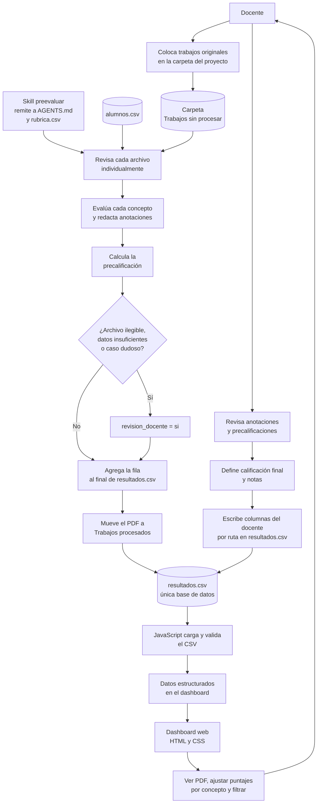

# Primera especificación del Preevaluador

## Propósito

Construir un flujo para que el docente organice los trabajos del alumnado, los preevalúe con un skill basado en la rúbrica del curso y consulte los resultados en un dashboard. El sistema registra observaciones y una precalificación; el docente conserva la decisión sobre la calificación final.

## Componentes y almacenamiento

- **Trabajos originales:** PDF de los alumnos. Los nuevos llegan a `Trabajos sin procesar/`. Tras preevaluarse, cada PDF se mueve a `Trabajos procesados/` con un nombre final único, y su `ruta` queda registrada en `resultados.csv`.
- **Roster:** `alumnos.csv` (`cuenta,nombre`), que llena el docente. Sirve para identificar a cada alumno.
- **Rúbrica:** `rubrica.csv` (versión v1, 9 conceptos, 10 puntos). La misma rúbrica aplica a las 7 entregas (E1 a E6 y TF). Cada concepto recibe un puntaje libre entre 0 y su máximo.
- **Reglas del agente:** `AGENTS.md` en la raíz del proyecto es la única fuente de reglas. El skill `.agents/skills/preevaluar/SKILL.md` solo remite a ese archivo. Los resultados son precalificaciones.
- **Resultados:** `resultados.csv` es la única base de datos, con dos grupos de columnas:
  - Columnas del agente (de `cuenta` a `anotaciones`): el agente solo agrega filas al final y nunca modifica las existentes.
  - Columnas del docente (`doc_*` por concepto, `calificacion_final`, `nota_docente`, `fecha_docente`): el agente las deja vacías. El dashboard las escribe mediante lectura, fusión y escritura, identificando cada fila por `ruta`.
- **Dashboard:** aplicación web hecha con HTML, CSS y JavaScript. Requiere Chrome o Edge por la File System Access API. Permite ver el PDF de cada trabajo, ajustar los puntajes por concepto, registrar la calificación final y notas, y escribir esos cambios de vuelta en `resultados.csv`.

## Diagrama de bloques del comportamiento

## Flujo esperado

1. El docente coloca los trabajos originales en `Trabajos sin procesar/` dentro del proyecto.
2. El skill toma cada archivo, identifica a qué estudiante y entrega corresponde y lo compara con la rúbrica configurada.
3. El skill registra el resultado para cada atributo de la rúbrica, las anotaciones que justifican la evaluación y una precalificación. No debe inventar datos ausentes ni aplicar criterios que no estén definidos.
4. Si no puede leer un archivo, asociarlo con certeza o evaluar un criterio con la información disponible, deja constancia y marca el caso para revisión del docente.
5. Los resultados se escriben en la hoja de cálculo CSV, manteniendo una fila por estudiante y entrega, salvo que el esquema acordado requiera otra estructura.
6. El dashboard carga el CSV, valida columnas y datos, y presenta el resumen del curso, el progreso de evaluación y el detalle por estudiante y entrega.
7. El docente revisa las anotaciones y precalificaciones y determina las calificaciones finales.

## Tecnologías

- **Interfaz:** HTML.
- **Presentación:** CSS.
- **Carga, validación, filtros y visualización:** JavaScript.
- **Almacenamiento tabular de resultados:** CSV.
- **Evaluación de archivos:** skill basado en la rúbrica y criterios de evaluación aprobados.

## Datos de evaluación conocidos

El curso contempla seis entregas y un trabajo final, con estas ponderaciones iniciales: entregas 1 y 2, 5% cada una; entregas 3 y 4, 10% cada una; entregas 5 y 6, 20% cada una; trabajo final, 30%. La suma es 100%.

Los criterios mencionados son carátula, referencias en formato APA, 7.ª edición, análisis estadísticos, mapas y conclusión. La rúbrica v1 (9 conceptos, 10 puntos) aplica a las 7 entregas. Cada concepto se puntúa de 0 al máximo indicado en `rubrica.csv`, y la precalificación es la suma de los 9 conceptos.

## Reglas de comportamiento

- Identificar todos los resultados como **precalificaciones**; no publicar ni asignar automáticamente una calificación final.
- Basar las revisiones exclusivamente en la rúbrica y los criterios aprobados para la entrega.
- Mantener trazabilidad entre cada resultado, el archivo original, el estudiante, la entrega y la versión de la rúbrica utilizada.
- No inventar puntajes, fechas, identidades, criterios ni contenido que falte en los archivos.
- Marcar explícitamente los casos que requieren revisión humana.
- Mostrar estados vacíos o errores de datos cuando el CSV no contenga información suficiente.
- Conservar anotaciones y resultados al actualizar los CSV.

## Decisiones pendientes

- Definir los reportes que se podrán exportar desde el dashboard.
